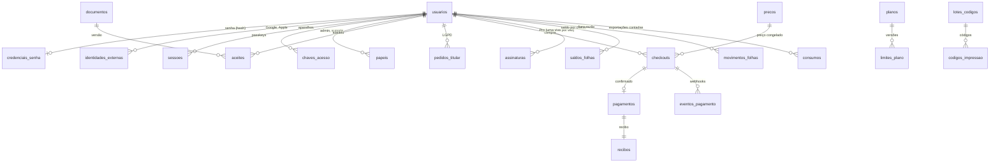

# Dados no servidor (PostgreSQL)

> **TL;DR.** O PolarLife continua local-first: foto, legenda, ajuste, projeto e EXIF **nunca** vão para o servidor (T5, BR-01).
> O banco existe só para o que precisa ser de verdade quando houver servidor: conta, plano, folhas (créditos), pagamentos,
> recibos, aceites, pedidos do titular e os registros que a lei exige. O esquema está em `db/` (oito migrações e uma semente),
> é aplicado e conferido por `tests/unit/testar-banco.mjs` num PostgreSQL descartável, e o manual de operação é o
> [`db/README.md`](../db/README.md). Decisão: D-206.

## 1. Princípios

1. **Minimização (LGPD art. 6º III).** Só entra no banco o dado sem o qual o serviço não funciona. Uma coluna nova com dado
   pessoal só entra com finalidade, base legal e prazo neste inventário (§2). O próprio teste do banco recusa qualquer coluna
   com nome de foto, miniatura, legenda, EXIF ou coordenada.
2. **Segredo não se guarda, se confere.** Senha (só o hash Argon2id, feito pela API), token de sessão (só o SHA-256),
   código de impressão e código por e-mail (só o HMAC-SHA-256, com a chave fora do banco). Nem o dono do banco lê um segredo
   em claro, porque ele não está lá.
3. **Menor privilégio.** Cada serviço entra com um papel que só faz o que precisa (§5). A API não lê tabela de segredo, o
   admin não lê HMAC, a análise só vê agregados, e só a auditoria lê os registros de acesso.
4. **A regra mora no banco.** Consumo de folha, crédito de pagamento, resgate de código e exclusão de conta são funções que
   rodam numa transação só. Dois cliques ao mesmo tempo não geram duas cobranças, nem crédito duplicado.
5. **Tudo deixa rastro, sem expor a pessoa.** Mudanças sensíveis vão para a trilha de auditoria, que guarda que algo mudou,
   e não o e-mail, o nome ou o segredo.
6. **Prazo legal é dado, não código.** Os prazos dos registros de acesso e da trilha ficam em `config.parametros`, e a
   rotina de retenção lê de lá (§3). Ela nunca aceita menos de 6 meses para os registros de acesso.

## 2. Inventário e classificação

Classes: **Segredo** (nunca em claro, nem para o admin), **Pessoal** (identifica a pessoa), **Financeiro** (pessoal, com
guarda fiscal), **Técnico** (sem pessoa ou só com chave interna), **Público** (pode ser visto por qualquer um).

| Dado | Onde | Classe | Para quê | Base legal (LGPD) | Prazo | Quem lê |
| --- | --- | --- | --- | --- | --- | --- |
| E-mail, nome | `identidade.usuarios` | Pessoal | Conta, entrada, recibos | Contrato (art. 7º V) | Enquanto a conta existir; na exclusão, apagados (pseudônimo) | A pessoa; admin |
| Hash da senha | `identidade.credenciais_senha` | Segredo | Conferir a senha | Contrato | Até trocar ou excluir | Só a função `conta_por_email` |
| «sub» do Google/Apple | `identidade.identidades_externas` | Pessoal | Entrar com o provedor | Contrato | Até excluir | A pessoa |
| Sessão (hash do token, aparelho) | `identidade.sessoes` | Segredo e pessoal | Manter a pessoa conectada | Contrato | Apagada 30 dias depois de vencer ou encerrar | A pessoa (sem o hash) |
| Código por e-mail (HMAC) | `identidade.codigos_verificacao` | Segredo | Entrar, confirmar e-mail, nova senha | Contrato | Apagado 1 dia depois de vencer | Só funções |
| Tentativas de entrada (HMAC do e-mail ou IP) | `identidade.tentativas_entrada` | Pessoal (pseudônimo) | Trava de força bruta | Legítimo interesse: segurança (art. 7º IX) | 1 dia | Só funções |
| Papel admin, passkeys | `identidade.papeis`, `chaves_acesso` | Segredo e pessoal | Painel do admin com MFA | Legítimo interesse: segurança | Até revogar | A pessoa; admin |
| Aceites de Termos, Privacidade e Cookies | `privacidade.aceites` | Pessoal | Provar o que foi aceito | Exercício regular de direitos (art. 7º VI) | 5 anos depois do fim da conta | A pessoa |
| Pedidos do titular | `privacidade.pedidos_titular` | Pessoal | Atender e provar o atendimento | Obrigação legal (art. 7º II, art. 18) | 5 anos | A pessoa; admin |
| Plano, assinatura, checkout | `comercial.assinaturas`, `checkouts` | Financeiro | Cobrar e liberar o Pro e as folhas | Contrato | 5 anos (fiscal) | A pessoa; admin |
| Pagamentos e recibos | `comercial.pagamentos`, `recibos` | Financeiro | Prova fiscal | Obrigação legal (art. 7º II; art. 16 I; CTN art. 173 e 174) | 5 anos, mesmo depois da exclusão | A pessoa; admin |
| Saldo e livro-razão de folhas | `comercial.saldos_folhas`, `movimentos_folhas` | Financeiro | Créditos | Contrato | 5 anos | A pessoa; admin |
| Exportações contadas | `comercial.consumos` | Pessoal | Regra das 24 h e folha grátis do mês | Contrato | 5 anos | A pessoa; admin |
| Resumo da folha (SHA-256) | `comercial.consumos.folha_hash` | Técnico | Reconhecer a mesma folha em 24 h | Contrato | Junto do consumo | Ninguém em claro (não dá para voltar à folha) |
| Códigos de impressão (HMAC e 4 últimos) | `comercial.codigos_impressao` | Segredo | Uso único do código vendido | Contrato | 5 anos | Admin (sem o HMAC) |
| Registros de acesso (IP, porta, data, rota) | `auditoria.registros_acesso` | Pessoal | Marco Civil, art. 15 | Obrigação legal (art. 7º II) | **6 meses**, sob sigilo | Só a auditoria |
| Trilha de auditoria | `auditoria.eventos` | Técnico (sem e-mail, nome nem segredo) | Quem mudou o quê | Legítimo interesse: segurança e prova | 5 anos | Só a auditoria |
| Preferências de aviso e inscrições de push | `avisos.preferencias`, `inscricoes_push` | Pessoal | Avisar no canal e na hora que a pessoa escolheu | Consentimento (art. 7º I) para o aparelho; contrato para o painel | Até a pessoa mudar, sair do aparelho ou excluir a conta | A pessoa (sem as chaves do push) |
| Entregas de avisos | `avisos.entregas` | Pessoal | Não repetir aviso; contar aberturas | Legítimo interesse | 1 ano | A pessoa; admin só em contagem |
| Cupons (HMAC, final, rótulo) e usos | `comercial.cupons`, `usos_cupons` | Segredo e financeiro | Desconto, uso único por conta | Contrato | 5 anos (fiscal) | Admin (sem o HMAC); a pessoa vê os próprios usos |
| Planos, limites, preços, chaves | `comercial.planos`, `limites_plano`, `precos`, `config.*` | Público e técnico | Regras do produto | — | Histórico completo | API e admin |

**Fora do banco, sempre:** foto, miniatura, legenda, ajuste, projeto, coordenada, EXIF, endereço temporário do Google Fotos,
dados de cartão (o checkout é hospedado pelo provedor) e as chaves de HMAC (ficam no cofre de segredos).

## 3. Retenção e descarte

| Item | Prazo | Como sai |
| --- | --- | --- |
| Registros de acesso | 6 meses (mínimo legal; a rotina não aceita menos) | Partição mensal apagada inteira (`auditoria.descartar_antigas`) |
| Trilha de auditoria | 5 anos | Partição mensal apagada inteira |
| Sessões | 30 dias depois de vencer ou encerrar | `auditoria.limpar_expirados` |
| Códigos por e-mail, tentativas | 1 dia | `auditoria.limpar_expirados` |
| Exportação de dados | Arquivo por 24 h | Marcada como expirada e sem referência; a API apaga o arquivo do armazenamento privado |
| Checkout não pago | 3 dias | Marcado como expirado |
| Conta excluída | Imediato | E-mail, nome, senha, sessões, provedores, passkeys e papéis apagados; folhas zeradas; ficam só pagamentos, recibos, aceites e o histórico de folhas, sem nome nem e-mail (art. 16 I) |
| Pagamentos, recibos, aceites, pedidos, consumos, livro-razão e códigos | 5 anos | `[PENDENTE]` A rotina de descarte entra antes de o primeiro prazo vencer (o banco ainda não está no ar) |

As cópias de segurança herdam o prazo da cópia (7 dias). Um dado apagado some das cópias quando a última cópia que o tinha vence.

## 4. Direitos do titular (LGPD art. 18 e 19)

| Direito | Como o PolarLife atende | Função |
| --- | --- | --- |
| Confirmação e acesso | «Exportar meus dados»: JSON legível com tudo o que o servidor guarda, e o aviso de que fotos e projetos nunca estiveram lá | `privacidade.exportar_dados` |
| Portabilidade | O mesmo JSON. Os projetos já são da pessoa, no aparelho (arquivo `.polarlife`) | `privacidade.exportar_dados` |
| Correção | A pessoa edita o nome; o e-mail muda com um código mandado ao e-mail novo | `UPDATE (nome)` com RLS; `novo_codigo` e `trocar_email` |
| Eliminação | «Excluir conta», em dois toques, com o que fica e por quê | `privacidade.excluir_conta` |
| Revogação e informação | Pedido registrado e respondido | `privacidade.pedidos_titular` |

Prazo: resposta completa em até **15 dias** (art. 19 II). O banco grava `prazo_em` em cada pedido, e um índice lista os
pedidos abertos por prazo, para o painel.

## 5. Segurança

**Papéis (só de grupo nas migrações; o login é criado por ambiente, `db/README.md`):**

| Papel | Faz | Não faz |
| --- | --- | --- |
| `pl_app` (API) | Lê as próprias linhas (RLS por `app.usuario_id`); chama as funções de conta, folhas, pagamento, código e LGPD; grava registro de acesso | Ler segredo, ler outra conta, ler registros de acesso, mudar preço ou limite |
| `pl_admin` (painel) | Lê contas e vendas sem segredos; muda limite, preço e códigos por função (cada chamada confere o papel admin); muda chaves e parâmetros direto na tabela (tudo vai para a trilha) | Ler HMAC, hash ou token; apagar trilha |
| `pl_auditor` | Lê a trilha e os registros de acesso (pedido de autoridade, incidente) | Mudar qualquer coisa |
| `pl_analitica` | Lê visões agregadas por mês | Ler qualquer tabela com pessoa |
| `pl_manutencao` | Roda partições, retenção e limpeza | Ler conteúdo |

**Camadas:**
- `public` fechado; um esquema por assunto; nenhuma função executável por `PUBLIC`.
- RLS ligada em toda tabela com pessoa. Permissões por coluna: a API nunca recebe `token_hash`, HMAC ou credenciais.
- Funções `SECURITY DEFINER` com `search_path` fixo (sem sequestro de função), conferindo o dono (`PL004`) ou o papel admin.
- Trilha e livro-razão só de inclusão: nem o dono do banco altera ou apaga linha (a retenção derruba a partição inteira).
- Tipos com regra na origem: e-mail normalizado, dinheiro em centavos inteiros, moeda ISO 4217, hash de 32 bytes.
- Conexão: TLS obrigatório (`verify-full`), sem IP público, SCRAM-SHA-256 ou IAM, tempo máximo por consulta.
- Entrada: Argon2id (m ≥ 19 MiB, t ≥ 2, p = 1, OWASP); trava de 5 erros em 15 min por e-mail e por IP; código por e-mail
  com 5 tentativas e no máximo 5 pedidos por hora (`PL006`); trocar a senha encerra as outras sessões. A API exige passkey
  para entrar no painel do admin (as chaves ficam em `chaves_acesso`; o banco confere o papel admin em cada função).
- Pagamento: crédito só depois da confirmação do provedor, com o valor conferido com o checkout; webhook com assinatura
  conferida e idempotente por evento; o preço de quem comprou nunca muda (preço é versão).

**Erros com código próprio (a API traduz para a tela):** `PL001` sem folhas · `PL002` código não encontrado · `PL003`
código usado, revogado ou vencido · `PL004` acesso negado · `PL005` conta já existe · `PL006` muitos pedidos de código.

## 6. Incidentes e transferência internacional

- **Incidente** com risco ou dano relevante: comunicar a ANPD e as pessoas afetadas em até **3 dias úteis** (LGPD art. 48;
  Resolução CD/ANPD nº 15/2024). Roteiro: conter (revogar sessões e chaves, girar segredos) → avaliar (o que vazou, de quem;
  a trilha e os registros de acesso dizem quem fez o quê) → comunicar → registrar (o registro do incidente fica guardado por
  5 anos). Como o banco não tem foto nem segredo em claro, o pior caso é e-mail, nome e histórico de compras.
- **Transferência internacional:** hospedar o banco no Brasil (`southamerica-east1`, São Paulo) evita a transferência para o
  dado principal. Os provedores fora do Brasil (pagamento internacional, e-mail transacional) precisam das cláusulas-padrão
  da ANPD (Resolução CD/ANPD nº 19/2024) e de menção na Política de Privacidade (DOC-09). `[VALIDAR com o jurídico, P5]`
- **Encarregado (DPO):** canal de contato publicado na Política de Privacidade. Agente de pequeno porte pode ter regras
  simplificadas (Resolução CD/ANPD nº 2/2022). `[VALIDAR]`
- **Registro das operações (art. 37):** este inventário (§2) é a base. Ele é atualizado em toda migração que mexa com dado pessoal.

## 7. Arquitetura

| Esquema | Tabelas | Observação |
| --- | --- | --- |
| `identidade` | usuarios, credenciais_senha, identidades_externas, sessoes, codigos_verificacao, papeis, chaves_acesso, tentativas_entrada | Exclusão vira pseudônimo (o id fica, sem e-mail nem nome) |
| `privacidade` | documentos, aceites, pedidos_titular, exportacoes | O texto legal fica no site; aqui, o SHA-256 da versão aceita |
| `comercial` | planos, limites_plano, precos, variantes_conta, assinaturas, checkouts, eventos_pagamento, pagamentos, recibos, saldos_folhas, movimentos_folhas, consumos, lotes_codigos, codigos_impressao | Limites e preços com vigência (`tstzrange`) e sem sobreposição |
| `config` | chaves, parametros | Chaves de funcionalidade avaliadas no servidor (sem SDK de terceiro no cliente) |
| `auditoria` | eventos, registros_acesso (particionadas por mês) | Só de inclusão |
| `analise` | contas_por_mes, vendas_por_mes, folhas_por_mes | Visões sem dado pessoal |
| `util` | migracoes e funções de apoio | UUIDv7, pessoa atual, mês de Brasília |

**Chaves:** UUIDv7, nativo no PostgreSQL 18. É ordenado no tempo (índices compactos) e tem parte aleatória: não revela
quantos registros existem, só o instante em que cada um foi criado.
**Tempo:** sempre `timestamptz` em UTC; o mês da folha grátis é o de Brasília. **Dinheiro:** centavos inteiros, nunca float.

**Identidade própria ou provedor de autenticação.** O DOC-12 §6.3 recomenda um provedor (Supabase Auth, Clerk, Auth0). O
esquema `identidade` serve aos dois caminhos. Com um provedor, `usuarios.id` recebe o id dele, e as tabelas de senha,
sessão, código e tentativa ficam sem uso. O resto (folhas, compras, LGPD, auditoria) não muda.

## 8. Do PLCONTA (demonstração no aparelho) para o servidor

Hoje o `PLCONTA` (`site/assets/js/nucleo/conta.js`) simula tudo no `localStorage` (`modo: 'demo'`). Com servidor, cada
chamada vira uma rota da API (nomes `[RECOMENDADO]`), e a API chama a função do banco:

| PLCONTA | Rota da API | Banco |
| --- | --- | --- |
| `criarConta`, `entrarComSenha` | `POST /auth/senha` | `criar_conta` · `conta_por_email` (a API confere o Argon2id) · `registrar_tentativa` · `criar_sessao` |
| `entrarComProvedor` | `GET /auth/google/retorno` | `entrar_com_provedor` · `criar_sessao` |
| `pedirCodigo`, `confirmarCodigo` | `POST /auth/email/inicio`, `/fim` | `novo_codigo` · `conferir_codigo` · `criar_sessao` |
| `definirSenha` | `POST /conta/senha` | `definir_senha` (ou `redefinir_senha` pelo código) |
| `sessao`, `sair` | toda rota; `POST /auth/sair` | `sessao_valida` · `encerrar_sessao` · `encerrar_sessoes` |
| `plano`, `direito`, `limites` | `GET /conta/direito` | `direito_de_uso` (o JSON do contrato do DOC-12 §6.4) |
| `consumir` | `POST /folhas/consumo` | `consumir_folhas` (regra das 24 h, grátis do mês, crédito, `PL001`) |
| `comprar`, `assinarPro` | `POST /checkout` + webhook | INSERT em `checkouts` (RLS) · `registrar_evento_pagamento` |
| `cancelarPro` | `POST /conta/assinatura/cancelar` | `cancelar_assinatura` |
| `verificarCodigo` (código de impressão) | `POST /codigos/resgate` | `resgatar_codigo` (`PL002`, `PL003`) |
| `exportarDados` | `GET /conta/dados` | `exportar_dados` |
| `excluirConta` | `DELETE /conta` | `excluir_conta` |
| Painel Admin | `/admin/*` | `novo_limite`, `novo_preco`, `criar_lote_codigos`, `revogar_codigo`, `ajustar_folhas` |
| `conferirCupom`, `usarCupom` (D-208) | `POST /cupons/conferir` · no `POST /checkout` | `conferir_cupom` · `usar_cupom` (`PL007`, `PL008`, `PL009`) |
| `PLAVISOS.salvarPrefs`, permitir notificações | `PUT /conta/avisos/preferencias` · `POST /conta/avisos/push` | `avisos.salvar_preferencias` · `inscrever_push` · `cancelar_push` |
| Painel de avisos (campanhas, abrir, dispensar) | `GET /conta/avisos` · `POST /conta/avisos/{id}` | `avisos.caixa` · `avisos.marcar` |
| Admin › Notificações e Cupons | `/admin/avisos/*`, `/admin/cupons/*` | `salvar_campanha`, `mudar_campanha`, `salvar_modelo`, `novo_cupom`, `mudar_cupom` |

## 9. Gestão

- **Mudança de esquema:** migração nova e numerada, nunca a edição de uma aplicada (o aplicador confere o SHA-256). Antes de
  aplicar, `node tests/unit/testar-banco.mjs` aplica tudo num banco descartável e confere as regras. Mudanças sem travar
  tabela: `db/README.md`.
- **Qualidade do dado:** restrições no próprio banco (tipos com regra, `CHECK`, `UNIQUE`, `EXCLUDE`, chaves estrangeiras).
  O saldo é sempre a soma do livro-razão, e o teste confere isso.
- **Rotinas:** partições, retenção e limpeza agendadas (`pg_cron` ou um job da API), com o papel `pl_manutencao`.
- **Observação:** `pg_stat_statements` para consultas lentas. Alerta para conexões perto do limite e para um webhook
  recusado várias vezes. Os logs do servidor ficam sem conteúdo de usuário.
- **Cópias e restauração:** backup diário, PITR ligado, restauração testada a cada trimestre (`db/README.md`).
- **Donos:** o dono do produto aprova dado pessoal novo e mudança de prazo. A IA de código só propõe e testa.

## 10. Onde hospedar (decisão em aberto)

Recomendação registrada em D-206. Ainda não vale provisionar um banco pago: o site não tem API, e um banco sem uso só gera
custo e superfície de ataque. Primeiro registrar o domínio próprio e decidir onde a API roda. Quando a API existir:

1. PostgreSQL gerenciado **na região de São Paulo**. Cloud SQL `southamerica-east1` é a escolha natural se a API rodar no
   Google Cloud (Cloud Run), com IAM, rede privada, backup e PITR. Supabase ou Neon na região São Paulo também atendem.
2. Começar com uma instância pequena, sem alta disponibilidade; ligar a réplica em outra zona quando houver cobrança real
   (`pagamento.real`).
3. Aplicar `db/migracoes` e `db/sementes` com o aplicador do teste, criar os papéis de login do ambiente e ligar as rotinas.

`[PENDENTE]` Escolha do provedor da API e do banco · `[VALIDAR P5]` revisão jurídica do inventário, das bases legais e dos prazos.
